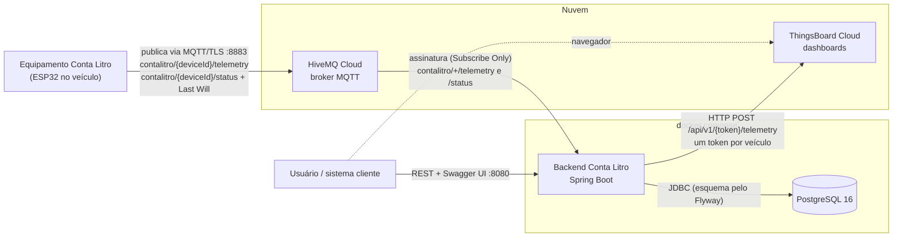
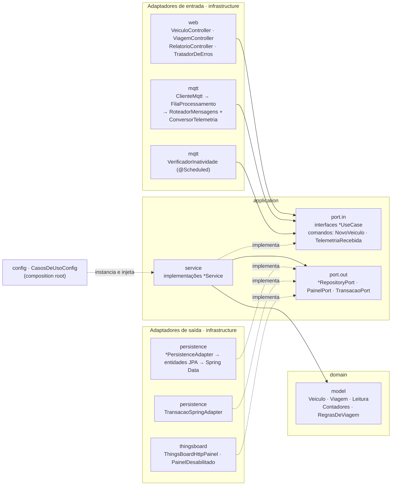
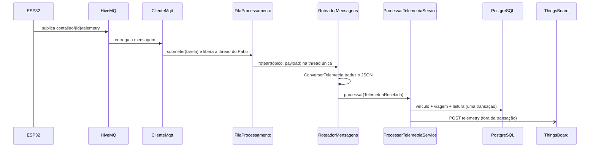

# Conta Litro — Backend

Recebe a telemetria publicada pelo equipamento Conta Litro no broker MQTT (HiveMQ),
guarda o histórico por veículo, organiza as leituras em viagens e envia os dados ao
ThingsBoard. O backend **só lê** o broker: não publica nada e não fala com o equipamento.

**Stack:** Java 21, Spring Boot 4.1, Spring Data JPA (Hibernate 7), Flyway,
PostgreSQL 16 (prod) / H2 (dev e testes), Eclipse Paho MQTT 1.2.5, springdoc-openapi
(Swagger UI), Docker.

## Arquitetura

### Visão geral do sistema



| Peça | Papel | Padrão |
|---|---|---|
| ESP32 → HiveMQ | O equipamento publica e não conhece quem consome | **Publish/Subscribe** |
| Tópico `status` | O broker publica `offline` sozinho quando o equipamento cai | **Last Will and Testament** (MQTT) |
| HiveMQ → Backend | O backend só assina, não publica nem comanda o equipamento | **Consumidor** de mensagens, credencial de menor privilégio |
| Backend → ThingsBoard | Repasse por HTTP: um único cliente atende a frota inteira | **Gateway** de integração (API de dispositivos) |
| Backend → PostgreSQL | Histórico, viagens e relatórios | Banco relacional versionado por **migrações** (Flyway) |
| `.env` + `docker compose` | A mesma imagem roda em qualquer ambiente | **Configuração externalizada** (12-factor) |

### Arquitetura do software

Arquitetura **hexagonal (Ports & Adapters)**, organizada nas camadas da **Arquitetura Limpa**:

```
infrastructure ──► application ──► domain
 (adaptadores)      (casos de uso)   (regras de negócio)
```



As dependências apontam só para dentro. `domain` e `application` são Java puro, sem Spring
nem JPA. Trocar o broker, o painel ou o banco não muda nenhuma regra de negócio. Os adaptadores
de entrada chamam os casos de uso pelas interfaces de `port.in`. Os casos de uso falam com o
mundo externo só pelas interfaces de `port.out`, que a `infrastructure` implementa
(**inversão de dependência**).

| Pacote | Conteúdo |
|---|---|
| `domain.model` | `Veiculo`, `Viagem`, `Leitura`, `Contadores`, `RegrasDeViagem` e os enums |
| `application.port.in` | Casos de uso (interfaces) e seus comandos/resultados |
| `application.port.out` | Portas de saída: repositórios, `PainelPort` e `TransacaoPort` |
| `application.service` | Implementação dos casos de uso |
| `infrastructure.persistence` | Entidades JPA, Spring Data e os adaptadores dos repositórios |
| `infrastructure.web` | Controllers REST, DTOs e tratamento de erros |
| `infrastructure.mqtt` | Cliente Paho, fila de processamento, roteador e contrato de entrada |
| `infrastructure.thingsboard` | Envio HTTP ao ThingsBoard |
| `infrastructure.config` | Propriedades e ligação dos casos de uso ao Spring |

### Padrões de projeto

| Padrão | Onde | Para quê |
|---|---|---|
| **Ports & Adapters** | `application.port.in` / `port.out` e os pacotes de `infrastructure` | Isolar as regras de negócio de framework, banco, broker e painel |
| **Use Case / Application Service** | `*UseCase` + `*Service` | Uma classe por operação do sistema, testável sem Spring |
| **Command** (objeto de entrada) | `NovoVeiculo`, `AlteracaoVeiculo`, `TelemetriaRecebida` | O caso de uso recebe dados já validados, sem depender de JSON ou HTTP |
| **Composition Root / Injeção de dependência** | `CasosDeUsoConfig` | Único lugar que monta os casos de uso; o resto do código não conhece o Spring |
| **Domain Model** (entidades ricas) | `Veiculo`, `Viagem` (`abrir`, `fechar`, `registrarComunicacao`) | O estado só muda pelas regras do domínio |
| **Value Object** | `Contadores`, `DadosTelemetria`, `Leitura` (records imutáveis) | Valores comparados pelo conteúdo e sem efeitos colaterais |
| **Domain Service** | `RegrasDeViagem.aplicar` → `Transicao` | Decisão de abrir, atualizar ou fechar viagem, em função pura |
| **Static Factory Method** | `Viagem.abrir`, `Leitura.registrar`, `Veiculo.autoCadastrado` | Construção com nome de negócio e invariantes garantidas |
| **Repository** | `*RepositoryPort` → `*PersistenceAdapter` | A aplicação pede objetos de domínio, não tabelas |
| **Data Mapper** | `*Entity.de(...)` / `paraDominio()` | Entidade JPA separada do modelo de domínio |
| **Adapter** (GoF) | `*PersistenceAdapter`, `TransacaoSpringAdapter`, `ThingsBoardHttpPainel` | Traduzir as portas para Spring Data, `TransactionTemplate` e HTTP |
| **Strategy + Null Object** | `PainelPort` → `ThingsBoardHttpPainel` ou `PainelDesabilitado` | Com `TB_ENABLED=false` o envio vira um no-op, sem `if` no caso de uso |
| **Unit of Work** (fronteira transacional) | `TransacaoPort.executar` | Veículo, viagem e leitura gravados juntos ou nada |
| **Producer-Consumer** (thread única) | `FilaProcessamento` | Libera a thread do Paho e garante ordem e exclusão sem locks |
| **Message Router** | `RoteadorMensagens` | Escolhe o caso de uso pelo tópico (`telemetry` ou `status`) |
| **Message Translator / Anti-Corruption Layer** | `ConversorTelemetria` | Isola o formato do firmware; se o JSON mudar, só ele muda |
| **Idempotent Receiver** | `ProcessarTelemetriaService` (mesmo `deviceId` + `ts`) | Descarta mensagens repetidas na reconexão do MQTT |
| **DTO** | `infrastructure.web.dto` | O contrato da API é separado do domínio; o token nunca sai na resposta |
| **Exception Handler centralizado** | `TratadorDeErros` (`@RestControllerAdvice`, RFC 9457) | Erros no formato `application/problem+json` |
| **Graceful Shutdown** | `SmartLifecycle` em `ClienteMqtt` e `FilaProcessamento` | Para de receber, esvazia a fila e só então fecha o banco |

### Caminho de uma mensagem



1. `ClienteMqtt` recebe a mensagem, anota o instante de chegada e a coloca na
   `FilaProcessamento`, liberando a thread do Paho na hora (senão o keepalive atrasa).
2. A fila tem **uma única thread**: a ordem de chegada importa para as viagens.
3. `RoteadorMensagens` escolhe o caso de uso pelo tópico e `ConversorTelemetria` traduz o JSON.
4. `ProcessarTelemetriaService` grava veículo, viagem e leitura em **uma transação**.
5. O envio ao ThingsBoard acontece **fora da transação**: um painel lento ou fora do ar não
   trava o banco nem desfaz o que foi gravado.

### Regras de viagem

A viagem é um **recorte** dos contadores do equipamento, que acumulam desde que ele liga.
Ao abrir, o backend guarda os contadores daquele instante como base, e a viagem vale
`atual − base`. Se uma mensagem se perder, a próxima traz o valor absoluto e corrige a viagem.

| Situação | O que acontece | Motivo gravado |
|---|---|---|
| Ignição ligada e nenhuma viagem aberta | Abre uma viagem | — |
| Distância do equipamento voltou para trás | Fecha a atual e abre outra | `REINICIO_EQUIPAMENTO` |
| Ignição desligada | Fecha a viagem | `IGNICAO_DESLIGADA` |
| Status offline (Last Will) | Fecha a viagem | `EQUIPAMENTO_OFFLINE` |
| Nenhuma mensagem por 10 minutos | Fecha a viagem (tarefa agendada) | `SEM_COMUNICACAO` |

Leituras descartadas: JSON malformado ou sem `data`; `vehicle_online = false`; mesmo
equipamento e mesmo `ts` já gravados (duplicata de reconexão); equipamento desconhecido com
auto-cadastro desligado.

## Contrato MQTT

> **Atenção:** a documentação do projeto não define os nomes dos campos do JSON. O formato
> abaixo é uma proposta e está todo concentrado em
> [`ConversorTelemetria`](src/main/java/com/gabriel/backendcontalitros/infrastructure/mqtt/ConversorTelemetria.java)
> e no seu teste de contrato. Se o firmware usar outros nomes, só esses dois arquivos mudam.

**`contalitro/{deviceId}/telemetry`**

```json
{
  "ts": 1790000000000,
  "vehicle_online": true,
  "data": {
    "speed_kmh": 62.5, "rpm": 2100, "gear": 4, "ignition": true,
    "fuel_level_pct": 73.2, "fuel_flow_lph": 5.8, "instant_kml": 10.7, "eco_score": 82,
    "distance_km": 12.34, "fuel_used_l": 1.18, "cost_brl": 7.08,
    "idle_time_s": 120, "harsh_accel": 2, "harsh_brake": 1
  }
}
```

- `ts`: epoch em milissegundos do ESP32. Ausente, nulo ou anterior a 2020 é tratado como
  relógio sem NTP (a leitura é aceita, só sem `instante_equipamento`).
- `distance_km` até `harsh_brake`: contadores **acumulados desde que o equipamento ligou**.
- Campos omitidos valem zero (ou nulo, se opcionais); campos desconhecidos são ignorados.
- O objeto `data` é repassado sem alteração ao ThingsBoard.

**`contalitro/{deviceId}/status`**: `online` / `offline` em texto puro, `{"status":"offline"}`
ou `{"online":false}`.

## Como executar

### Com Docker (PostgreSQL + backend)

```bash
cp .env.example .env        # opcional; ajuste MQTT_* e TB_* se for usar
docker compose up -d --build
```

A API responde em http://localhost:8080. No perfil `prod` o auto-cadastro fica desligado:
cadastre o veículo (`POST /veiculos`) antes de o equipamento enviar dados.

Para rodar só o banco e o backend pela IDE: `docker compose up -d postgres` e
`./mvnw spring-boot:run -Dspring-boot.run.profiles=prod`.

### Sem Docker (H2 em memória)

```bash
./mvnw spring-boot:run
```

### Variáveis de ambiente

| Variável | Padrão | Descrição |
|---|---|---|
| `DB_HOST`, `DB_PORT`, `DB_NAME`, `DB_USER`, `DB_PASSWORD` | `localhost`, `5432`, `contalitro`… | PostgreSQL (perfil `prod`) |
| `AUTO_CADASTRO` | `true` (dev) / `false` (prod) | Cadastra equipamentos desconhecidos |
| `MQTT_HOST` | vazio | Sem ele o cliente MQTT não conecta |
| `MQTT_PORT`, `MQTT_PROTOCOL` | `8883`, `ssl` | Use `1883` e `tcp` para um broker local |
| `MQTT_USER`, `MQTT_PASSWORD` | vazio | Credencial do broker (pode ser Subscribe Only) |
| `MQTT_CLIENT_ID` | `contalitro-backend` | Precisa ser único no broker |
| `TB_ENABLED`, `TB_URL` | `false`, `https://thingsboard.cloud` | Envio ao ThingsBoard |

## API REST

A forma mais fácil de testar é pelo **Swagger UI**: abra http://localhost:8080 (redireciona
para `/swagger-ui.html`), escolha a rota e use **Try it out**. A especificação OpenAPI fica em
`/v3/api-docs`.

| Método | Rota | Retorno |
|---|---|---|
| POST | `/veiculos` | Cadastra um veículo (201, ou 409 se o `deviceId` já existe) |
| PATCH | `/veiculos/{id}` | Edita o cadastro (só os campos enviados; `""` remove placa, modelo ou token). Use para cadastrar o token do ThingsBoard depois |
| GET | `/veiculos` | Lista os veículos |
| GET | `/veiculos/{id}/viagens` | Viagens do veículo, da mais recente para a mais antiga |
| GET | `/veiculos/{id}/leituras` | Leituras no período (padrão: última hora) |
| GET | `/viagens/{id}` | Detalhe de uma viagem (404 se não existe) |
| GET | `/relatorios/consumo` | Consumo e custo por veículo (padrão: últimos 30 dias) |

Filtros de período: `de` e `ate` em ISO-8601 UTC, ex.: `?de=2026-10-01T00:00:00Z`.
Erros seguem a RFC 9457 (`application/problem+json`). O token do ThingsBoard nunca
aparece nas respostas.

```json
POST /veiculos
{
  "deviceId": "contalitro-001",
  "placa": "ABC1D23",
  "modelo": "Caminhão 1",
  "capacidadeTanqueL": 45,
  "metaConsumoKml": 10,
  "thingsboardToken": "token-do-device"
}
```

```json
PATCH /veiculos/1
{
  "thingsboardToken": "token-do-device"
}
```

## Testes

```bash
./mvnw test
```

64 testes, sem precisar de banco ou broker instalados:

- **Domínio:** recorte dos contadores, regras de abertura e fechamento de viagem.
- **Aplicação:** casos de uso com repositórios em memória (sem Spring).
- **Contrato:** leitura do JSON publicado pelo Conta Litro, incluindo campos omitidos e desconhecidos.
- **Fluxo:** do texto recebido no tópico até o banco (H2), incluindo Last Will e inatividade.
- **Persistência:** adaptadores JPA sobre o esquema do Flyway.
- **ThingsBoard:** adaptador HTTP contra um servidor local.
- **API:** cadastro, consultas, relatório, respostas 400, 404 e 409 e a documentação OpenAPI.

Ainda não testado com os serviços reais: HiveMQ Cloud (TLS e credenciais) e ThingsBoard Cloud.
